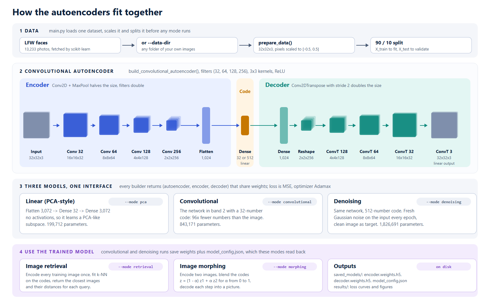

# Architecture guide

How the three autoencoders are built and trained, and how retrieval and morphing use them. For commands and flags see the [usage guide](usage.md).



## The idea

An autoencoder is two networks trained together:

```
image x  ->  encoder  ->  code z  ->  decoder  ->  reconstruction x̂
```

The code is much smaller than the image: a 32x32 colour image is 3,072 numbers and the default code is 32. Training minimises the reconstruction error

```
loss = mean((x - decoder(encoder(x)))²)
```

over the training images. Nothing else is supervised: the image is its own target. Because the code is too small to copy the input, the encoder must keep the information that best explains the image and the decoder must fill in the rest. Images that look alike end up with codes that are close together, which is what retrieval and morphing rely on.

## Data pipeline

`utils/data_loader.py`

1. **Load.** `load_lfw_dataset()` fetches all 13,233 Labeled Faces in the Wild photos through scikit-learn, takes a square 125x125 crop around the face from each 250x250 photo and resizes it to the target size. `load_image_folder()` instead reads every image under a folder (`--data-dir`), converts it to RGB and resizes it. Both return float32 arrays with pixel values in [0, 255].
2. **Scale.** `prepare_data()` maps pixels to [-0.5, 0.5] (`x / 255 - 0.5`). Centring on zero suits the linear output layer of the decoders.
3. **Split.** 90 percent for training and 10 percent held out (`--test-size`), with `random_state=42` so every mode sees the same split.

## Shared interface

Every builder in `models/` returns `(autoencoder, encoder, decoder)`. The autoencoder is the encoder followed by the decoder, built from the same layer objects, so training the autoencoder trains both halves and the halves can be used on their own afterwards. All three models are compiled with the Adamax optimiser and mean squared error loss, with mean absolute error reported as a metric.

## 1. Linear (PCA-style) autoencoder

`models/pca_autoencoder.py`

| Layer | Output | Parameters |
|-------|--------|------------|
| Input | 32x32x3 | 0 |
| Flatten | 3,072 | 0 |
| Dense (code), no activation | 32 | 98,336 |
| Dense, no activation | 3,072 | 101,376 |
| Reshape | 32x32x3 | 0 |
| **Total** | | **199,712** |

With no activations the whole model is the affine map `x̂ = W_d (W_e x + b_e) + b_d`. The best such map under squared error projects onto the top principal components of the data, so this model learns the same subspace as PCA (though not necessarily the same basis). It is the baseline the non-linear models have to beat.

Training: up to `--epochs`, early stopping after five epochs without validation improvement (best weights restored), learning rate halved after three.

## 2. Convolutional autoencoder

`models/convolutional_autoencoder.py`, default `filters=(32, 64, 128, 256)`, all kernels 3x3 with `same` padding.

**Encoder**

| Layer | Output | Parameters |
|-------|--------|------------|
| Input | 32x32x3 | 0 |
| Conv2D 32, ReLU + MaxPool 2x2 | 16x16x32 | 896 |
| Conv2D 64, ReLU + MaxPool 2x2 | 8x8x64 | 18,496 |
| Conv2D 128, ReLU + MaxPool 2x2 | 4x4x128 | 73,856 |
| Conv2D 256, ReLU + MaxPool 2x2 | 2x2x256 | 295,168 |
| Flatten | 1,024 | 0 |
| Dense (code), linear | 32 | 32,800 |
| **Encoder total** | | **421,216** |

**Decoder**

| Layer | Output | Parameters |
|-------|--------|------------|
| Input (code) | 32 | 0 |
| Dense, ReLU | 1,024 | 33,792 |
| Reshape | 2x2x256 | 0 |
| Conv2DTranspose 128, stride 2, ReLU | 4x4x128 | 295,040 |
| Conv2DTranspose 64, stride 2, ReLU | 8x8x64 | 73,792 |
| Conv2DTranspose 32, stride 2, ReLU | 16x16x32 | 18,464 |
| Conv2DTranspose 3, stride 2, linear | 32x32x3 | 867 |
| **Decoder total** | | **421,955** |

**Autoencoder total: 843,171 parameters** with a 32-number code; 1,039,875 with 128.

Each pooling step halves the width and height while the filter count doubles, so early layers respond to edges and colour and later layers to larger structures such as eyes, hairlines and face outlines. A stride-2 transposed convolution is a learned upsampling: it doubles the width and height, and its weights are trained to put detail back rather than just interpolate. The final layer has no activation so the output can cover the full [-0.5, 0.5] range. The code layer is linear too: with a ReLU there, a quarter of the 32 code units never switched on for any face, which left an effective code of 24 numbers.

Image size must be divisible by 16 (four poolings). The decoder always mirrors the encoder because its first dense layer is sized from the encoder's last feature map.

Training: up to `--epochs`, early stopping after ten epochs without validation improvement (best weights restored), learning rate halved after five (down to 1e-7), best model saved to `checkpoints/conv_autoencoder_best.keras`, and TensorBoard logs in `logs/convolutional/` when TensorBoard is installed.

## 3. Denoising autoencoder

`models/denoising_autoencoder.py`

The network is the convolutional autoencoder with a 512-number code (1,826,691 parameters). What changes is the training data:

```
for each epoch:
    noisy_train = clean_train + N(0, σ²)     fresh noise every epoch
    fit(noisy_train -> clean_train)          clean image is the target
```

The model never sees the same noise twice, so it cannot memorise it. It has to learn what faces look like well enough to tell structure from noise. The larger code leaves room for detail; with 32 numbers the output is clean but blurry.

The loop keeps a copy of the weights from the epoch with the lowest validation loss (validated on noisy held-out images against clean ones), stops after ten epochs without improvement, and restores the best weights into the same model before returning. Because the encoder and decoder share layers with it, the weights saved to `saved_models/` are the best ones. The best full model is also written to `checkpoints/denoising_autoencoder_best.keras`.

`utils/noise.py` also provides salt and pepper noise and random square occlusions. They are available from Python through the `noise_function` argument of `train_denoising_autoencoder()`; the command line uses Gaussian noise.

## Applications

### Retrieval

`image_retrieval.py`

```python
search = ImageRetrieval(encoder, metric="euclidean")
search.index_images(X_train)                    # encode once, fit k-NN on the codes
distances, images = search.find_similar(query, n_neighbors=5)
```

Searching 32 numbers per image is much cheaper than comparing 3,072 pixels, and it compares what the encoder learned to keep (pose, lighting, face shape, background tone) rather than exact pixels. Any scikit-learn metric works, for example `metric="cosine"`.

### Morphing

`image_morphing.py`

```
z1 = encoder(a), z2 = encoder(b)
for α in linspace(0, 1, n_steps):
    frame = decoder((1 - α) z1 + α z2)
```

A plain autoencoder does not guarantee that points between two codes decode to realistic images, so mid-way frames can look washed out. A variational autoencoder, which regularises the code space, is the usual fix and is on the roadmap.

## Saving and loading

`save_weights()` writes `encoder.weights.h5` and `decoder.weights.h5` (Keras 3 weight files) plus `model_config.json`:

```json
{
  "mode": "convolutional",
  "code_size": 32,
  "image_size": 32
}
```

Retrieval and morphing read this file and rebuild the model with the same code and image size before loading the weights. `load_weights()` and `read_model_config()` do the same from Python.

## Measured results

On all 13,233 LFW faces at 32x32, laptop CPU (Intel Core i7-14650HX), TensorFlow 2.21:

| Model | Code size | Compression | Parameters | Test MSE |
|-------|-----------|-------------|------------|----------|
| Linear (PCA) | 32 | 96x | 199,712 | 0.0081 |
| Convolutional | 32 | 96x | 843,171 | 0.0074 |
| Denoising, σ = 0.1 | 512 | 6x | 1,826,691 | 0.0046 (noisy input: 0.0100) |

Training times and example images are in the [README](../README.md#results).

## Where to go from here

- Change `filters` in `build_convolutional_autoencoder()` for a wider or deeper network; the decoder follows automatically.
- Add batch normalisation or residual blocks for larger images.
- Replace MSE with a perceptual or SSIM loss for sharper reconstructions.
- Turn the code into a variational one (mean, log variance and a KL term) to sample new images.
